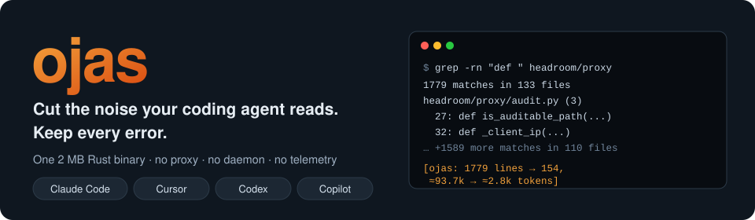
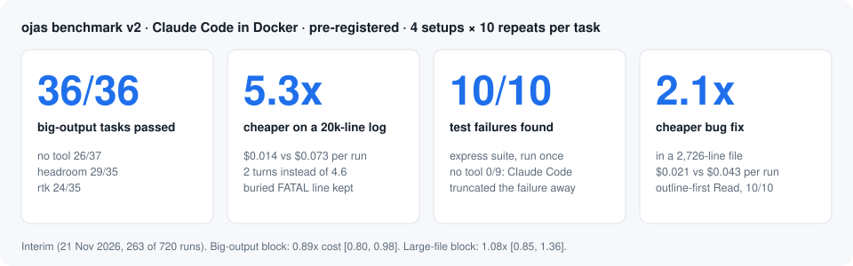
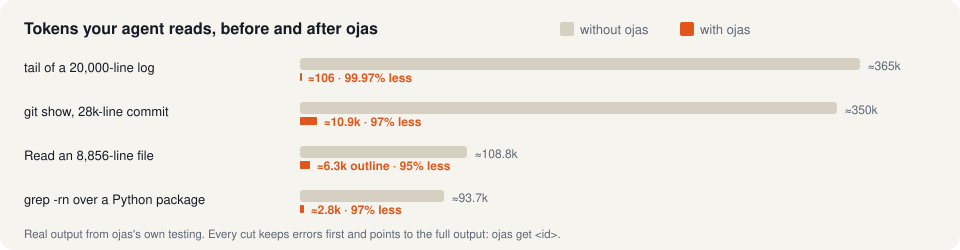
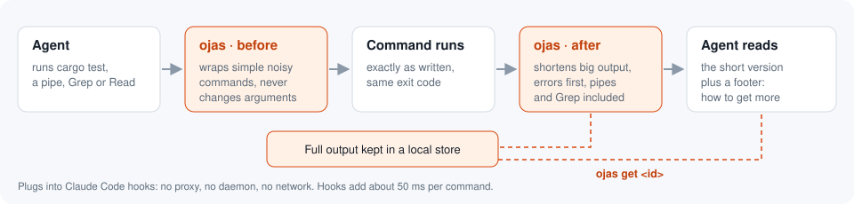

<p align="center"></p>

<p align="center">
  <a href="#install"><b>Install</b></a> ·
  <a href="#benchmark-v2"><b>Benchmark</b></a> ·
  <a href="https://claude.ai/artifact/42CU4Ke8QmYoX6W8GBQm4Z"><b>Full benchmark report</b></a> ·
  <a href="https://claude.ai/artifact/A2yW3uNsD5fcEVzCXBqL9H"><b>How we built ojas</b></a>
</p>

# ojas: token saver for AI coding agents

`ojas` cuts the tokens that coding agents (Claude Code first, any agent second) spend on **command output**. It is a single 2 MB Rust binary with no runtime, no proxy, no daemon and no telemetry.

<p align="center"><a href="#benchmark-v2"></a></p>

In a pre-registered, 720-run benchmark against no tool, [headroom](https://github.com/headroomlabs-ai/headroom) and [rtk](https://github.com/rtk-ai/rtk), ojas was **the only setup that passed every big-output task**, at **12% lower cost** and **17% fewer turns** than no tool, with no overhead on everyday tasks. [Full results and the tasks where ojas is not ahead →](#benchmark-v2)

```
$ ojas run -- grep -rn "def " headroom/proxy
1779 matches in 133 files
headroom/proxy/audit.py (3)
  27: def is_auditable_path(path: str) -> bool:
  32: def _client_ip(request: Any) -> str | None:
  37: def record_admin_action(
…
… +1589 more matches in 110 more files
[ojas: 1779 lines → 154, ≈93.7k → ≈2.8k tokens. Full output: ojas get f1b5d0481dd4]
```

## Why command output

<p align="center"></p>

In real agent sessions, most of the bill is **input**: tool output that enters the context and is then re-read on every later turn. On one developer's machine, `ojas audit` over 30 days of Claude Code use showed:

- **97.5% of input tokens were cache reads.** Whatever lands in the context gets paid for again on every turn after it.
- **About 120k tokens of shell output entered the context**, mostly from `grep`, `ls`, `find`, `cat` and `sed`.

Rules about response style help too, but less. caveman's own evals found a long "talk terse" rule set beats a plain "Answer concisely." by about 3%, while costing about 1.2k input tokens on every request. So ojas's style rules are about 150 tokens and off by default, and most of the effort goes into output filtering.

## How it works

<p align="center"></p>

1. **Hook rewrite.** In Claude Code, a `PreToolUse` hook rewrites noisy commands (`cargo test` becomes `ojas run -- cargo test`).
   - Only plain, simple commands are rewritten, or simple segments of `&&` / `||` / `;` chains.
   - Pipes, redirections, subshells, `$(…)` and env-var prefixes are left alone, so the program always receives exactly the same arguments.
   - **Everything else is compressed after it runs.** A `PostToolUse` hook handles commands the rewrite skips (pipes, loops, `cd x && …`, scripts) and the built-in Grep tool. The command runs exactly as written; the hook only replaces what the agent sees (Claude Code's `updatedToolOutput`). For output over Claude Code's ~30k-character inline limit, it reads the full saved copy, so nothing past the cut-off is missed. In a live test, `cat app.log | tail -n 20000` went from ≈365k tokens to ≈106, and the buried FATAL line stayed. Each call adds about 50 ms.
   - **Large whole-file reads with the Read tool become an outline.** That covers source files over 500 lines, read without `offset`/`limit`. Each outline line keeps its real line number, so the agent can then read just the part it needs with `offset`/`limit`, which is never changed. Large `.log`/`.out` files go through the generic filter instead. Claude Code still records the file as read, so Edit works normally. In a live A/B test (fix one function in a 2,605-line file), cost fell from $0.243 to $0.064 with the same number of turns and the same correct fix.
   - The hook never makes a permission decision. Your normal permission rules still apply.
2. **Fixed, rule-based filters.** The same input always gives the same output. There are no LLM calls, and replacing the same output gives identical bytes, which keeps prompt caches valid.

   | Filter | Commands | What it does |
   |---|---|---|
   | test | cargo test, pytest, jest, vitest, go test, mocha, dotnet test… | Hides passing tests and build progress. Keeps failures, panics, tracebacks and summaries. |
   | build | cargo build/clippy, npm/pnpm/yarn install, pip, tsc, eslint, ruff, make, gradle, docker build… | Drops progress and noise lines, and folds `npm WARN deprecated` spam into one line. |
   | git-diff | git diff, git show | Keeps changed lines with 1 line of context, collapses lockfiles to a count, adds a summary of files and lines changed. |
   | git-log | git log | One line per commit: hash, refs, date, author, subject. |
   | git-status | git status | Drops `(use "git …")` hints and caps long file lists. |
   | search | grep, rg, ag, git grep | Groups matches by file, shows at most 8 per file and 40 files, and says how many more there are. |
   | listing | find, fd, ls, tree | One line per directory. Hides `node_modules/`, `target/`, `.git/` and similar folders behind a count. Trims `ls -l` to names and sizes. |
   | json | any command whose output is JSON | Minifies, turns arrays of same-shaped objects into `{"_cols":…,"_rows":…}`, and samples long arrays while keeping error-looking items. The result is still valid JSON. |
   | generic | docker logs, kubectl, gh, curl… | Collapses repeated and near-identical lines, then keeps the head, the tail, and error lines. |

   Rules shared by every filter:
   - **Error lines come first.** Truncation gives error lines their own budget, and lines that differ only in numbers are never merged if they look like errors.
   - **Every gap is labelled**, e.g. `… 340 lines omitted (2 error-like, 5 warning-like) …`.
   - **Small output (40 lines or fewer and 3 KB or less) passes through untouched**, as does any output that would shrink by less than 15%.
   - **Exit codes are always preserved.**
3. **Nothing is lost.** Every original is stored locally (`~/.ojas/store`, kept 7 days). The footer names an id, and the agent can run:
   ```
   ojas get <id>                  # everything
   ojas get <id> --grep 'ERROR'   # matching lines, with line numbers
   ojas get <id> --lines 200:260  # a range
   ```
   If the original can't be stored, ojas prints the uncompressed output instead.
4. **Lean session context.** A `SessionStart` hook adds only a short note explaining the `[ojas: …]` footer. Response-style rules (about 150 tokens) are opt-in: in our benchmark they added turns and cost without shortening answers (see [Benchmark v2](#benchmark-v2)). The text never changes between sessions, so it doesn't break the prompt cache, and it is re-added after compaction.
5. **Outline-first file reads.** A plain `cat <one source file>` longer than 300 lines is rewritten to `ojas read <file>`, which prints an outline instead of the whole file:
   ```
   $ ojas read src/smart_crusher/crusher.rs
   36: use std::sync::Arc;
   … +9 more imports (lines 47-55)
   77: pub struct CrushArrayResult { … 31 lines }
   145: impl SmartCrusher {
   148:   pub fn crush_with_prose_hook(&self, content: &str, query: &str, bias: f64, hook: &ProseHook<'_>) -> CrushResult { … 27 lines }
   …
   [ojas: outline of a 2930-line file, ≈32k → ≈2.7k tokens. Bodies: ojas read <file> --symbol <name>, or --lines START:END. Whole file: --full]
   ```
   - The agent then reads only what it needs: `ojas read <file> --symbol SmartCrusher::crush`, `--symbol Store.Path` (Go receivers work too), or `--lines 140:200`.
   - Function bodies over 200 lines (app factories, closures) also list their nested definitions, which can be read as `--symbol create_app::handler`.
   - Files of 300 lines or fewer, and files in other languages, print in full, byte for byte, exactly like `cat`.
   - `cat` with flags, globs, variables, several files or a pipe is never rewritten.
   - Languages: Rust, Python, JavaScript/TypeScript, Go, Java, C#.
   - **How it parses:** a pure-Rust scanner, not tree-sitter, because tree-sitter grammars are C code and ojas stays free of C dependencies. A lexer removes comments and string contents, including raw strings, template literals with `${…}` nesting, and JS regex literals. Then a brace-aware (or, for Python, indent-aware) pass finds definitions. It is a heuristic for reading, never for editing.
6. **Repo map (opt-in).** `ojas map` lists the most-referenced definitions in the repo:
   - Ranking is by how many *other* files mention each name. Types weigh more than functions, methods and test files less.
   - The output is cut to a token budget (default 1,500).
   - Files come from `git ls-files`, so `.gitignore` is respected.
   - The output is fully sorted and cached by file size and modification time. It is byte-identical until the code changes, which keeps it prompt-cache friendly.
   - Set `"repo_map": true` to add it to the session context. In testing it took 0.64 s on a cold run and 0.2 s from cache on a 2,900-file repository.
7. **`ojas compress-md <file>`** compresses CLAUDE.md, AGENTS.md and similar files. It is rule-based, with no LLM:
   - It shortens wordy phrases ("in order to" becomes "to"), removes filler words ("basically", "really") and hedges, and trims padding from tables.
   - It never touches code blocks, inline code, URLs, paths, headings, front matter or list structure. A validator checks all of these and aborts without writing if anything changed.
   - The original is backed up to `~/.ojas/backups` first. `--dry-run` shows the token estimate, and `--stdout` prints the result. CRLF line endings are kept.
   - Expect small savings: 0–3% on the real docs tested. Files that are already terse gain nothing. Larger cuts (caveman reports about 33%) need an LLM rewrite, which ojas deliberately doesn't do.

## Install

Build from source with Rust 1.87 or later:

```sh
cargo install --path .        # or: cargo install --git <this repo's URL>
ojas init                     # adds the hooks to ~/.claude/settings.json
```

Prebuilt binaries for Linux, macOS and Windows (x86_64 and arm64) are attached to each GitHub release. They are built by `.github/workflows/release.yml` when a `v*` tag is pushed.

`ojas init` merges into your existing settings, keeps your other hooks, and writes a `settings.json.ojas-backup` first. Options:
- `--project` writes to `./.claude/settings.json`.
- `--settings <file>` writes to any file you name.
- `--dry-run` prints the result without writing.

Restart Claude Code after installing. `ojas uninit` removes only ojas's hooks.

> **Windows with the GNU toolchain:** the build works with the minimal `stable-x86_64-pc-windows-gnu` toolchain because ojas has no C dependencies. The MSVC toolchain works as well.

### Other agents (Cursor, Codex, Gemini CLI, …)

Agents without Claude Code hooks can call ojas directly. The easiest way is the ready-made skill in [`skills/ojas/`](skills/ojas/): copy it into your agent's skills folder. Or paste the output of `ojas rules` into `AGENTS.md`, `.cursor/rules`, `GEMINI.md` or similar. It tells the agent to run noisy commands as `ojas run -- <cmd>`. You can also pipe into a filter:

```sh
some-command 2>&1 | ojas filter --kind test
```

## Measure it

```sh
ojas gain [--days 7]      # per-filter savings recorded by ojas run (estimate: 1 token ≈ 4 bytes)
ojas audit [--days 30]    # real usage from Claude Code transcripts, plus which commands
                          # still send large output without going through ojas
```

On real output from this project's testing:

| Command | Before | After | Saved |
|---|---:|---:|---:|
| `git show` (large commit, 28k lines) | ≈350k tok | ≈10.9k tok | 97% |
| `grep -rn "def " <python package>` | ≈93.7k tok | ≈2.8k tok | 97% |
| `find . -name "*.py"` (1,873 files) | ≈18.3k tok | ≈3.6k tok | 80% |
| `gh api …/issues?per_page=30` (JSON) | ≈62.6k tok | ≈39.6k tok | 37% |

Outlines (`ojas read` / `ojas outline`) on real files:

| File | Lines | Whole file | Outline | Saved |
|---|---:|---:|---:|---:|
| headroom `content_router.py` | 8,856 | ≈108.8k tok | ≈6.3k tok | 95% |
| headroom `proxy/server.py` | 7,916 | ≈92.3k tok | ≈4.1k tok | 96% |
| headroom `smart_crusher/crusher.rs` | 2,930 | ≈32.2k tok | ≈2.7k tok | 92% |
| headroom `log_compressor.rs` | 2,769 | ≈27.8k tok | ≈3.2k tok | 89% |
| caveman `installer/install.js` | 2,981 | ≈37.0k tok | ≈2.0k tok | 95% |
| caveman `ccr/store_sqlite.go` | 1,343 | ≈12.4k tok | ≈1.3k tok | 90% |
| caveman `cli/src/agent-mcp.ts` | 684 | ≈5.9k tok | ≈1.1k tok | 82% |

These counts are byte-based estimates on single samples, not a benchmark of end-to-end agent cost. An outline only saves tokens if the agent then reads a few symbols rather than the whole file.

## Benchmark v2

> 📊 **[Full benchmark report](https://claude.ai/artifact/42CU4Ke8QmYoX6W8GBQm4Z)**: every table, intervals and caveats on one page.
>
> 📖 **[How we built ojas](https://claude.ai/artifact/A2yW3uNsD5fcEVzCXBqL9H)**: the problem, each step we took, and what the benchmarks taught us.

**720 runs, all valid.** ojas is the only tool tested that beat no tool by a clear margin anywhere: on big-output tasks it was **12% cheaper** and **passed every run**, against 28 of 40 for no tool. Everywhere else it cost the same as no tool (no overhead) and lost no runs. The one weak spot, large files where the agent needs every function body, is fixed in v0.3.

| Task group (cost vs no tool) | ojas | headroom | rtk | Passed: no tool / ojas / headroom / rtk |
|---|---:|---:|---:|---:|
| **Big output** (4 tasks) | **0.88x [0.79, 0.97]** | 0.99x [0.89, 1.10] | 1.01x [0.88, 1.14] | 28 / **40** / 34 / 26 of 40 |
| Ordinary coding (8 tasks) | 0.97x [0.89, 1.06] | 0.93x [0.85, 1.03] | 1.05x [0.97, 1.13] | 80 / 80 / 80 / 80 of 80 |
| Large files (3 tasks) | 1.08x [0.85, 1.36] → **0.93x [0.76, 1.11] in v0.3** | 1.15x [0.88, 1.49] | 0.95x [0.76, 1.17] | 30 / 29 → **30** / 30 / 30 of 30 |
| "Long" tasks (3 tasks) | 1.06x [0.97, 1.18] | 1.02x [0.92, 1.13] | 1.06x [0.97, 1.17] | 29 / 30 / 30 / 30 of 30 |

**Setup.** Claude Code 2.1.330 (model Sonnet 5.5) on a Claude subscription, each setup in its own Docker image: no tool, ojas (main before the v0.3 fixes, `abf4776`), headroom 0.44.0 and rtk 1.2.1, each with its default install. There are 18 tasks in 4 groups and 10 repeats of every task per setup. Tasks, graders, hypotheses and analysis were fixed in a pre-registration before the first run, and every run is reported. Graders are deterministic and run outside the agent. Cost is the list price Claude Code reports. Ratios are task-balanced means against no tool, brackets are 95% stratified bootstrap intervals, and pass rates use Fisher's exact test.

### Big-output tasks: ojas is cheaper and more correct

Prompts that force large output: a full test suite run once with no piping (click, express), a full read of click's 4,018-line `core.py`, and `cat` of a 20,000-line log with one buried fatal line.

| Setup | Cost vs no tool | Turns | Output tokens | Passed |
|---|---:|---:|---:|---:|
| no tool | 1.00x | 1.00x | 1.00x | 28/40 |
| **ojas** | **0.88x [0.79, 0.97]** | **0.83x [0.77, 0.90]** | **0.71x [0.63, 0.79]** | **40/40** (p < 0.001) |
| headroom | 0.99x [0.89, 1.10] | 1.09x [0.98, 1.22] | 1.02x [0.91, 1.14] | 34/40 |
| rtk | 1.01x [0.88, 1.14] | 1.29x [1.15, 1.46] | 1.16x [1.04, 1.31] | 26/40 |

| Task (mean cost per run, passed) | no tool | ojas | headroom | rtk |
|---|---:|---:|---:|---:|
| Run click's test suite | $0.027 (10/10) | $0.029 (10/10) | $0.033 (10/10) | $0.040 (10/10) |
| Run express's test suite | $0.028 (**0/10**) | **$0.015 (10/10)** | $0.034 (4/10) | $0.049 (0/10) |
| Read all of click's `core.py` | $0.280 (10/10) | $0.303 (10/10) | $0.280 (10/10) | $0.264 (10/10) |
| Find the error in a 20,000-line log | $0.073 (8/10) | **$0.012 (10/10)** | $0.058 (10/10) | $0.058 (6/10) |

Why no tool fails the express task: Claude Code keeps about 30,000 characters of Bash output and drops the middle, which is where the failing test was. One no-tool run reported: *"the tool output was truncated in the middle (about 18,800 characters dropped)… It has no failure marker, no mocha summary."* ojas puts failure lines first, so the agent found the failure every time.

### Large source files: fixed in v0.3

**Fix a pricing bug**: one boundary bug in a 2,726-line file. **Trace every error**: list every function in a 2,580-line file that can raise an error, by reading only, which needs every function body. **Fix a bug in click**: a bug injected into click's 4,018-line `core.py`.

| Task (mean cost per run, passed) | no tool | ojas before v0.3 | **ojas v0.3** | headroom | rtk |
|---|---:|---:|---:|---:|---:|
| Fix a pricing bug | $0.043 (10/10) | $0.021 (10/10) | $0.031 (10/10) | $0.051 (10/10) | $0.037 (10/10) |
| Trace every error | $0.089 (10/10) | $0.131 (9/10) | **$0.089 (10/10)** | $0.111 (10/10) | $0.080 (10/10) |
| Fix a bug in click | $0.053 (10/10) | $0.049 (10/10) | $0.052 (10/10) | $0.050 (10/10) | $0.057 (10/10) |
| **Group, cost vs no tool** | 1.00x | 1.08x [0.85, 1.36] | **0.93x [0.76, 1.11]** | 1.15x [0.88, 1.49] | 0.95x [0.76, 1.17] |

Outlines cut cache reads by a third (0.69x [0.64, 0.74] in v0.3). Before v0.3, when the agent needed every function body it read the outline and then fetched most of the file again, so "trace every error" cost 48% more and one run failed. v0.3 leaves output the agent already filtered alone and returns the full text on a repeated whole-file Read. With that, the task costs the same as no tool and passes every run.

The v0.3 column is an extra arm run after the pre-registered 720 (logged as a deviation). It ran a day later and alone, so prompt-cache warmth differed. The pricing task's higher cost comes from that: v0.3 made exactly the same tool calls as before, and the difference is cache writes.

### Long sessions: not yet tested

The three "long" tasks were meant to take 25+ turns but finished in a median of 5, 6 and 16, so savings couldn't accumulate. ojas cost the same as no tool there and passed every run. A follow-up study with tasks that really take 25+ turns is running (no tool vs ojas v0.3, pre-registered), and its result will be added here.

**Caveats.** Ten repeats per task gives wide intervals. There's no correction across 3 setups × 4 groups, so treat single p-values near 0.05 as weak. One model and one harness version were tested. On a subscription, "cost" measures how fast usage limits are used up, not money spent.

**Benchmark v1** (8 ordinary tasks × 3 runs): the hook itself cost nothing (0.96x [0.85, 1.07] of no tool, 24/24 passed). Response-style rules made answers longer and added turns (1.04x), so they are now off by default.

## Configuration

Settings live in `~/.ojas/config.json`. Every field is optional:

```json
{
  "enabled": true,
  "style": "off",
  "min_lines": 40,
  "min_bytes": 3000,
  "max_lines": 150,
  "diff_max_lines": 400,
  "store_days": 7,
  "read_min_lines": 300,
  "read_tool_min_lines": 500,
  "repo_map": false,
  "repo_map_budget": 1500
}
```

- `style` sets the session rules: `off` (the default: only the note about the `[ojas: …]` footer), `lite`, or `full`.
- `read_min_lines`: `cat` of a source file longer than this becomes an outline.
- `read_tool_min_lines` (default 500): a whole-file Read-tool read of a longer source file shows its outline. `0` turns this off. Reads with `offset` or `limit` are never changed.
- `repo_map` / `repo_map_budget`: add a repo map of about this many tokens to the session context.

Environment variables:
- `OJAS_RAW=1 <cmd>` skips one command. The hook doesn't rewrite commands that start with an env assignment.
- `OJAS_DISABLE=1` makes both hooks do nothing.
- `OJAS_HOME` moves the data directory.
- `OJAS_BIN` sets how the agent's shell should call ojas.

To check how a command would be rewritten: `ojas rewrite "cd web && npm test"`.

## Limits (v0.3)

- **Output the agent already narrowed is left alone.** That means pipelines ending in `grep`, `head`, `tail`, `sed`, `awk`, `sort`, `jq` and similar, or `sed -n`/`head`/`tail` reads. It is only compressed when it is still over about 30k characters, where Claude Code would otherwise show only a short preview.
- **Reading a whole large file a second time in a session returns the full text.** The first whole-file Read shows the outline; repeating it means the agent needs everything.
- **Filters are chosen from the command text.** In a pipeline ending in anything other than `head`/`tail` (say `| grep` or `| sort`), the output has been reshaped, so ojas uses the generic filter. Exit codes are not visible to the PostToolUse hook; they are preserved because the command itself is never changed.
- **Output is buffered**, so long-running commands show nothing until they finish. Background commands and `--watch` / `--follow` / `-f` are never wrapped.
- **Read-tool outlines can cost an extra turn.** When the agent needs a whole large file, it has to read it again with `offset`/`limit`. Raise `read_tool_min_lines`, or set it to 0, if that happens often in your work. Grep in `files_with_matches` or `count` mode is left alone.
- **The structure scanner is heuristic.**
  - Unusual syntax (macros that open blocks, C-preprocessor tricks, deeply nested JS object factories) can produce a coarse outline. `--full` and `--lines` always give the exact file.
  - Top-level JS calls with callbacks (`describe(...)`, `app.get(...)`) are elided rather than outlined.
- **The repo map ranks by name references, not resolved symbols.** Two unrelated things with the same name share credit.
- **compress-md saves little on files that are already well written** (see above).

## Roadmap

- More outline languages (Kotlin, Swift, C/C++, Ruby, PHP).
- Filters learned from `ojas audit` ("missed savings") data, and more test and build formats.
- Long-session benchmark (25+ turn tasks, running now). If repeated test runs turn out to dominate long sessions, show only what changed since the previous run.
- Outlines that keep short function bodies in full, for tasks that need to trace every body.

## Credits

ojas reimplements ideas; it does not copy code. The ideas come from these projects:
- [caveman](https://github.com/juliusbrussee/caveman): style rules (answer-first, keep negations, plain prose for warnings), and replacements that are always the same so the prompt cache survives.
- [headroom](https://github.com/headroomlabs-ai/headroom): compressors that always keep errors, recoverable compression (CCR), arrays of objects turned into column/row form, and treating the prompt cache as sacred.
- [rtk](https://github.com/rtk-ai/rtk): rewriting commands in a PreToolUse hook, and filters chosen per command.
- [context-mode](https://github.com/mksglu/context-mode): keep raw output out of the context but retrievable.
- [ccusage](https://github.com/ccusage/ccusage): measuring from real transcripts.
- [aider](https://github.com/Aider-AI/aider) repo map, [repomix](https://github.com/yamadashy/repomix) `--compress`, and [serena](https://github.com/oraios/serena) / [codegraph](https://github.com/colbymchenry/codegraph): definitions ranked by references, signature-only views, and reading one symbol instead of a whole file.

## License

Dual-licensed under MIT or Apache-2.0, at your option.
